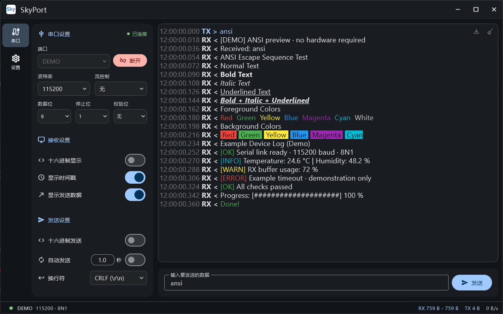

<div align="center">


# SkyPort

[English](README.md) · **简体中文**

**面向嵌入式开发与硬件测试的桌面串口调试助手**

连接设备，收发文本与 Hex 数据，查看 ANSI 彩色日志，导出调试记录。

[](https://github.com/StarSphere-1024/SkyPort/actions/workflows/ci.yml) [](https://github.com/StarSphere-1024/SkyPort/releases/latest) [](LICENSE)

[下载安装](#下载安装) · [快速开始](#快速开始) · [更新记录](https://github.com/StarSphere-1024/SkyPort/releases) · [从源码运行](#从源码运行) · [问题反馈](#问题反馈)

支持 **Windows / Linux** · **文本 / Hex** 收发 · **中英文**界面

</div>

<p align="center">
  
</p>

## 功能亮点

- **串口连接**：扫描可用端口，配置波特率、数据位、停止位、校验位与流控制，记忆常用参数。
- **文本与 Hex 收发**：切换发送与接收显示模式；文本发送可配置追加换行及 LF / CR / CRLF 格式。
- **日志查看与导出**：支持 ANSI 彩色显示、时间戳和收发记录区分，可调整日志缓冲区并导出调试记录。
- **重复调试**：通过发送历史和可配置间隔的自动发送，减少重复输入。
- **连接状态与统计**：查看连接状态、收发字节与接收速率，按需启用设备断开后的自动重连。
- **桌面体验**：中英文界面，浅色、深色与跟随系统主题，记忆窗口尺寸和位置。

## 下载安装

前往 **[最新发行版](https://github.com/StarSphere-1024/SkyPort/releases/latest)** 下载。历史版本与更新记录见 [Releases](https://github.com/StarSphere-1024/SkyPort/releases)。

| 平台 | 安装包 | 如何选择 |
| --- | --- | --- |
| Windows | 安装版 `-setup.exe` / 便携版 `-portable.zip` | 安装版按向导安装；便携版完整解压后运行 `skyport.exe` |
| Linux | `.deb` / `.rpm` / `.AppImage` | Debian / Ubuntu 优先选择 `.deb`；Fedora 等 RPM 系发行版选择 `.rpm`；AppImage 赋予执行权限后运行 |

两种平台均提供 `amd64`（x64 / x86_64）和 `arm64`（ARM64 / aarch64）包。Intel / AMD 的 x64 电脑选 `amd64`，ARM 设备选 `arm64`；不确定时先查看系统的处理器架构。

> 便携版必须保留完整目录，不要只复制可执行文件或删除附带的动态库、资源目录。当前支持 Windows 和 Linux；macOS 暂不支持，仓库中的 macOS 项目文件不代表可用发行版。

## 快速开始

1. **连接设备**：将串口设备接入电脑，启动 SkyPort，在“串口设置”中选择端口。
2. **匹配参数**：按设备要求设置波特率、数据位、停止位、校验位与流控制，点击“连接”，确认状态变为“已连接”。
3. **发送数据**：在输入区填写设备支持的指令。文本模式按设备协议配置是否追加换行；发送二进制数据时启用“十六进制发送”并输入完整字节。
4. **查看响应**：在日志区查看收发记录，按需开启十六进制显示、时间戳或 ANSI 渲染。设备是否回显或应答取决于其协议。
5. **保留记录**：使用“导出日志”保存本次调试记录；重复发送同一内容时，可设置自动发送间隔。

自动重连用于恢复连接，不代表失败的数据已补发。发生发送错误时，请查看错误提示与已写入字节数，再决定下一步操作。

## 常见问题

**找不到串口或连接失败？**

确认设备已被操作系统识别、相关驱动已安装，端口未被其他程序占用。Linux 下还需检查当前用户对该串口设备的访问权限；不要通过长期以 root 运行应用来绕过权限配置。

**接收内容乱码，或发送后没有响应？**

先核对设备的通信参数、文本 / Hex 模式与换行要求。二进制数据应使用十六进制显示检查；ANSI 渲染用于带有转义序列的文本日志，不会让二进制数据变成可读文本。

**导出日志能找回已丢失的数据吗？**

不能。导出仅包含当前保留的记录；缓冲区淘汰或数据缺口不能通过导出恢复。需要长期保留的调试记录请及时导出。

## 从源码运行

### 环境准备

- Flutter / Dart：满足 [`app/pubspec.yaml`](app/pubspec.yaml) 中的 SDK 约束。可参考 [CI 配置](.github/workflows/test.yml) 使用的工具链版本。
- Rust stable，通过 rustup 安装对应平台的编译目标。
- Windows：Visual Studio 的“使用 C++ 的桌面开发”工具链。
- Linux：Clang、CMake、Ninja、`pkg-config`、GTK3 与 libudev 开发包。Debian / Ubuntu 可安装：

  ```bash
  sudo apt-get install clang cmake ninja-build pkg-config libgtk-3-dev libudev-dev
  ```

仅运行 Rust 核心测试不需要 Flutter；Linux 仍需 `pkg-config` 与 libudev 开发包。

### 获取源码与依赖

```bash
git clone https://github.com/StarSphere-1024/SkyPort.git
cd SkyPort
cd app
flutter pub get
```

### 运行与构建

以下命令从 `app/` 执行，选择与当前宿主系统对应的一组：

**Windows**

```bash
flutter run -d windows
flutter build windows --release
```

**Linux**

```bash
flutter run -d linux
flutter build linux --release
```

Flutter 的 Windows / Linux CMake 构建会调用 Cargo，并将 Rust bridge 动态库放入产物目录。分发时须保留完整 bundle：Windows 的 `skyport_flutter_bridge.dll` 与 `.exe` 相邻，Linux 的库位于 `lib/libskyport_flutter_bridge.so`。

## 开发与贡献

SkyPort 使用 Rust + Flutter：独立的 Rust 核心负责串口生命周期、数据收发、配置持久化、日志、统计与调度；Flutter 负责桌面界面与交互，通过 `flutter_rust_bridge` 接入核心。

架构与数据、队列、配置迁移约定见 [Rust 核心设计](docs/rust-serial-kernel-design.md)。依赖与版本以 [Flutter 清单](app/pubspec.yaml)、[Cargo 清单](Cargo.toml) 和各自的 lockfile 为准。

提交 Pull Request 时，请说明使用场景、变更行为与验证结果。修复问题时附上复现步骤；修改跨层接口时同步更新 Rust、bridge 与 Dart 消费方。

<details>
<summary>本地检查与真实串口路径验证</summary>

从仓库根目录运行 Rust 核心测试和 Flutter 单元 / 组件测试：

```bash
cargo test --locked -p skyport_core
tool/test_quiet.sh
```

Windows 等没有 Bash 的环境，从 `app/` 运行 `dart ../tool/quiet_flutter_test.dart`。静态分析同样从 `app/` 运行：

```bash
flutter analyze
```

以下命令从仓库根目录执行：

```bash
python3 scripts/pty_ui_smoke.py
python3 scripts/package_smoke.py <bundle或发行包路径>
```

- `pty_ui_smoke.py`：仅 Linux，使用真实 UI、bridge 和伪终端验证收发与生命周期。
- `package_smoke.py`：在对应平台检查完整 bundle、deb、rpm、AppImage 或 Windows portable zip 的加载与生命周期。Windows 安装版须先安装到隔离目录，再检查该目录。
- Linux 检查需要显示环境；无显示时为命令加上 `xvfb-run -a`。
- RPM 包检查需要 `bsdtar`，Debian / Ubuntu 可安装 `libarchive-tools`。
- Windows 使用本机 Python 命令（通常为 `python`）替代 `python3`。

伪终端验证不能替代物理串口、其他架构和实际硬件验收。

</details>

<details>
<summary>修改 bridge API 后生成绑定</summary>

仅在相关 API / 类型变化后生成绑定，不要手工修改生成文件。生成器版本与 [bridge 清单](crates/skyport_flutter_bridge/Cargo.toml) 保持一致。

从仓库根目录执行：

```bash
cargo install flutter_rust_bridge_codegen --version 2.13.0 --locked
cd app
flutter_rust_bridge_codegen generate --config-file flutter_rust_bridge.yaml
```

</details>

## 问题反馈

通过 [GitHub Issues](https://github.com/StarSphere-1024/SkyPort/issues) 报告 Bug 或提出建议。提交前请先搜索已有问题，并尽量提供：

- 应用版本、操作系统版本与处理器架构。
- 复现步骤、预期行为和实际结果。
- 相关串口参数、文本 / Hex 模式及换行配置。
- 错误提示、诊断详情、相关日志或截图。

分享日志前请移除密钥、设备标识及其他敏感数据。功能建议请描述实际调试场景与希望解决的问题。

## 许可证

SkyPort 采用 [GNU Affero General Public License v3.0](LICENSE) 许可证。

由 [StarSphere-1024](https://github.com/StarSphere-1024) 维护。
